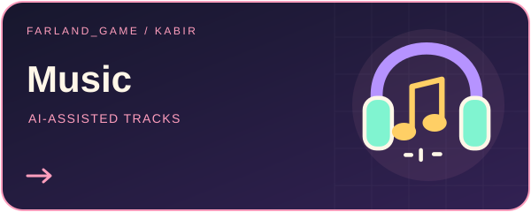

# موسیقی و طراحی کاور 🎧

<!-- PROJECT_VISUAL_HEADER -->

[← Farland_game / Portfolio](https://github.com/FarlandGame#portfolio-directory)
<!-- PROJECT_VISUAL_HEADER_END -->

**Bardiya Alizadeh · Kabir · Farland_game**

[English](https://github.com/FarlandGame/Music-Portfolio/blob/main/README.md) · [فارسی](https://github.com/FarlandGame/Music-Portfolio/blob/main/docs/README.fa.md) · [日本語](https://github.com/FarlandGame/Music-Portfolio/blob/main/docs/README.ja.md) · [Deutsch](https://github.com/FarlandGame/Music-Portfolio/blob/main/docs/README.de.md) · [Français](https://github.com/FarlandGame/Music-Portfolio/blob/main/docs/README.fr.md) · [Español](https://github.com/FarlandGame/Music-Portfolio/blob/main/docs/README.es.md) · [Português (Brasil)](https://github.com/FarlandGame/Music-Portfolio/blob/main/docs/README.pt-BR.md) · [Italiano](https://github.com/FarlandGame/Music-Portfolio/blob/main/docs/README.it.md) · [Nederlands](https://github.com/FarlandGame/Music-Portfolio/blob/main/docs/README.nl.md) · [Polski](https://github.com/FarlandGame/Music-Portfolio/blob/main/docs/README.pl.md) · [Українська](https://github.com/FarlandGame/Music-Portfolio/blob/main/docs/README.uk.md) · [Türkçe](https://github.com/FarlandGame/Music-Portfolio/blob/main/docs/README.tr.md) · [Русский](https://github.com/FarlandGame/Music-Portfolio/blob/main/docs/README.ru.md) · [简体中文](https://github.com/FarlandGame/Music-Portfolio/blob/main/docs/README.zh-CN.md) · [繁體中文](https://github.com/FarlandGame/Music-Portfolio/blob/main/docs/README.zh-TW.md) · [한국어](https://github.com/FarlandGame/Music-Portfolio/blob/main/docs/README.ko.md) · [हिन्दी](https://github.com/FarlandGame/Music-Portfolio/blob/main/docs/README.hi.md) · [Bahasa Indonesia](https://github.com/FarlandGame/Music-Portfolio/blob/main/docs/README.id.md)

دو پروژهٔ موسیقی با کمک هوش مصنوعی، به زبان ژاپنی و فارسی؛ ساخته و هدایت‌شده توسط بردیا علیزاده، ملقب به کبیر، با نام هنری Farland_game.

[▶ شنیدن هر دو آهنگ](https://farlandgame.github.io/Music-Portfolio/) · [SoundCloud](https://soundcloud.com/bardiya-kabir-798008614) · [GitHub](https://github.com/FarlandGame)

> حالا فهرست مأموریت‌هایم موسیقی متن هم دارد؛ ظاهراً انیمیشن و کدنویسی هم آهنگ پس‌زمینه می‌خواستند! 🎮🎵

## 雨よ来い · Come, Rain

**ژاپنی · 1:55 · MP3 · 320 kb/s · 48 kHz · stereo**

[▶ شنیدن هر دو آهنگ](https://farlandgame.github.io/Music-Portfolio/#come-rain) · [⬇ دانلود فایل اصلی MP3](https://raw.githubusercontent.com/FarlandGame/Music-Portfolio/main/audio/come-rain.mp3)

[معرفی آهنگ](https://github.com/FarlandGame/Music-Portfolio/blob/main/tracks/come-rain.fa.md)

## چرخ زمان بازمیگردد · Time’s Wheel Turns Back

**فارسی · 1:34 · MP3 · 320 kb/s · 48 kHz · stereo**

[▶ شنیدن هر دو آهنگ](https://farlandgame.github.io/Music-Portfolio/#times-wheel-turns-back) · [⬇ دانلود فایل اصلی MP3](https://raw.githubusercontent.com/FarlandGame/Music-Portfolio/main/audio/times-wheel-turns-back.mp3)

[معرفی آهنگ](https://github.com/FarlandGame/Music-Portfolio/blob/main/tracks/times-wheel-turns-back.fa.md)

## روند ساخت

ایده‌پردازی: Claude ← نوشتن ترانه: ChatGPT ← ساخت موسیقی: Suno ← استخراج صدا: InShot ← طراحی کاور: Photoshop و هوش مصنوعی. به گفتهٔ سازنده، هر دو اثر در SoundCloud او هم منتشر شده‌اند.

نام سازنده برای ایده‌پردازی، هدایت تولید با ابزارهای هوش مصنوعی و طراحی بصری آمده است؛ این معرفی ادعای خوانندگی انسانی یا آهنگ‌سازی بدون هوش مصنوعی ندارد. فایل‌های صوتی و پوسترهای تحویلی بدون تغییر حفظ شده‌اند.

[Credits & reuse](https://github.com/FarlandGame/Music-Portfolio/blob/main/CREDITS.md) · [File catalogue](https://github.com/FarlandGame/Music-Portfolio/blob/main/catalogue.json)
