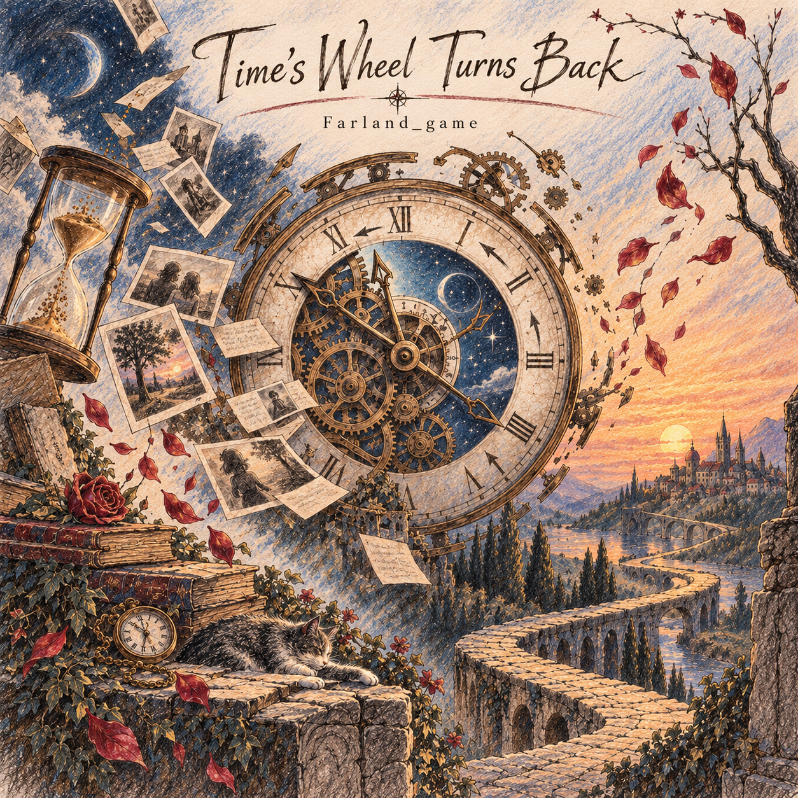

# چرخ زمان بازمیگردد · Time’s Wheel Turns Back 🎵

[English](https://github.com/FarlandGame/Music-Portfolio/blob/main/tracks/times-wheel-turns-back.en.md) · [فارسی](https://github.com/FarlandGame/Music-Portfolio/blob/main/tracks/times-wheel-turns-back.fa.md) · [日本語](https://github.com/FarlandGame/Music-Portfolio/blob/main/tracks/times-wheel-turns-back.ja.md)

[▶ شنیدن هر دو آهنگ](https://farlandgame.github.io/Music-Portfolio/#times-wheel-turns-back) · [⬇ دانلود فایل اصلی MP3](https://raw.githubusercontent.com/FarlandGame/Music-Portfolio/main/audio/times-wheel-turns-back.mp3) · [SoundCloud](https://soundcloud.com/bardiya-kabir-798008614)

این پروژهٔ موسیقی فارسی را **بردیا کبیر / Farland_game** با کمک ابزارهای هوش مصنوعی ساخته و هدایت کرده است. نام فایل تحویلی **چرخ زمان بازمیگردد** و عنوان انگلیسی روی پوستر **Time’s Wheel Turns Back** است.

کاور، ساعتی مکانیکی با چرخ‌دنده‌ها، ساعت شنی، عکس‌های پراکنده، کتاب‌ها و برگ‌های پاییزی دارد. مسیر سنگی پیچ‌داری هم به شهری در دوردست می‌رسد. این هویت بصری کنار پوستر بارانی اثر ژاپنی، دو ارائهٔ متفاوت می‌سازد؛ این توصیفِ پوستر است، نه نقل‌قول از ترانه.

ایده‌پردازی: Claude ← نوشتن ترانه: ChatGPT ← ساخت موسیقی: Suno ← استخراج صدا: InShot ← طراحی کاور: Photoshop و هوش مصنوعی. به گفتهٔ سازنده، هر دو اثر در SoundCloud او هم منتشر شده‌اند.

> حالا فهرست مأموریت‌هایم موسیقی متن هم دارد؛ ظاهراً انیمیشن و کدنویسی هم آهنگ پس‌زمینه می‌خواستند! 🎮🎵

**MP3 · 94.87 s · 320 kb/s · 48 kHz · stereo**

SHA-256: `874feaa3352ff485fbfedc9964e83aef69458b966801e943d22216546ceef5ff`

[← موسیقی و طراحی کاور](https://github.com/FarlandGame/Music-Portfolio/blob/main/docs/README.fa.md)
